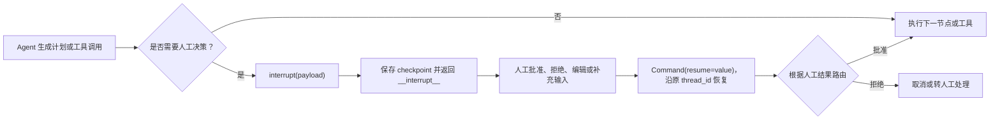

# Agent Teams 与 LangChain MCP 初始化说明

## 1. 项目已启用的能力

项目级配置位于 `.codex/config.toml`，当前已启用：

```toml
[features]
multi_agent = true

[agents]
enabled = true
max_concurrent_threads_per_session = 3
```

- `multi_agent = true`：启用 Codex 多代理协作工具。
- `agents.enabled = true`：启用子代理工作流。
- `max_concurrent_threads_per_session = 3`：最多同时运行 3 个子代理；主代理不计入该数量。

## 2. LangChain MCP

### 明确结论

**在本项目中，LangChain MCP 的主要职责是获取 LangChain 官方最新的文档规范。**

它不负责实现 Agent Teams 的调度，也不负责执行 `interrupt` 或 Human-in-the-loop 流程。后两项属于 LangGraph 图执行与状态持久化的职责。

项目接入了两台 LangChain 官方 MCP 文档服务器：

```toml
[mcp_servers.langchain-docs]
url = "https://docs.langchain.com/mcp"

[mcp_servers.langchain-reference]
url = "https://reference.langchain.com/mcp"
```

| 服务器 | 主要内容 |
| --- | --- |
| `langchain-docs` | 官方概念说明、教程、操作指南与最佳实践 |
| `langchain-reference` | 官方 API 参考，包括类、方法、参数与签名 |

MCP 是让 LLM 以统一方式发现和调用外部工具、读取外部上下文的协议。在当前配置中，它提供的是实时、只读的 LangChain 文档与 API 参考能力。

## 3. LangGraph `interrupt` 的作用

`interrupt()` 是 LangGraph 的动态暂停原语。图执行到调用点时，会暂停并等待外部输入；恢复后，外部输入会成为该 `interrupt()` 调用的返回值。

它依赖以下要素：

1. **Checkpointer**：保存图状态；生产环境应使用持久化存储。
2. **`thread_id`**：恢复同一个流程的持久标识。
3. **JSON 可序列化 payload**：发送给人工界面或调用方的审批、审阅或补充信息。
4. **`Command(resume=...)`**：携带外部输入、恢复同一个图线程。

```python
from langgraph.types import Command, interrupt

def approval_node(state):
    decision = interrupt({
        "action": "send_email",
        "to": state["to"],
        "question": "是否允许发送？",
    })

    return Command(goto="send" if decision["action"] == "approve" else "cancel")

# 恢复时必须使用原来的 thread_id
graph.invoke(Command(resume={"action": "approve"}), config={
    "configurable": {"thread_id": "email-001"}
})
```

## 4. Human-in-the-loop 流程

Human-in-the-loop（HITL）是由 `interrupt` 支撑的业务审批流程：



典型使用场景：

| 场景 | 人工操作 |
| --- | --- |
| 高风险动作 | 批准或拒绝 API 调用、付款、删除、发信等 |
| 内容审阅 | 编辑 LLM 生成的文本后再继续 |
| 工具调用审阅 | 修改工具参数后批准执行，或取消调用 |
| 信息收集与校验 | 补齐缺失字段；不合法时重新提问 |

## 5. MCP、`interrupt` 与 HITL 的边界

| 能力 | 所属层 | 解决的问题 |
| --- | --- | --- |
| LangChain MCP | 集成层 | 从官方服务获取最新文档、规范与 API 参考；也可按需接入其他工具/资源 |
| `interrupt()` | LangGraph 运行时 | 将图执行暂停在动态位置并等待外部输入 |
| Human-in-the-loop | 业务流程层 | 定义何时需要人参与、展示什么信息，以及批准/编辑/拒绝后的路由 |

MCP 服务器自身的认证和授权仍然有效；人工审批是额外的业务控制，不能替代访问控制。

## 6. `interrupt` 实现约束

- 恢复必须使用同一 `thread_id`；新 ID 会开始新流程。
- 包含 `interrupt()` 的节点恢复时会从节点开头重新执行，因此暂停前的副作用必须幂等。
- 不要用宽泛的 `try/except` 捕获 `interrupt()`，否则暂停信号可能被吞掉。
- 一个节点中的多个 `interrupt()` 必须保持稳定的调用顺序。
- 不要在单个节点内用 `while True` 重复调用 `interrupt()`；应将校验结果写入 state，再通过条件边回到该节点。
- payload 与恢复值应保持 JSON 可序列化。

## 7. 验证记录

- `codex mcp list` 已显示 `langchain-docs` 与 `langchain-reference` 均为 enabled。
- 两个端点的 MCP `initialize` 握手均返回 HTTP 200。
- 已通过 `langchain-docs` 完成文档检索，并通过 `langchain-reference` 查询到 API 参考。

## 8. 官方资料

- [LangChain MCP 指南](https://docs.langchain.com/oss/python/langchain/mcp)
- [LangGraph Interrupts](https://docs.langchain.com/oss/python/langgraph/interrupts)
- [Human-in-the-loop](https://docs.langchain.com/langsmith/add-human-in-the-loop)
